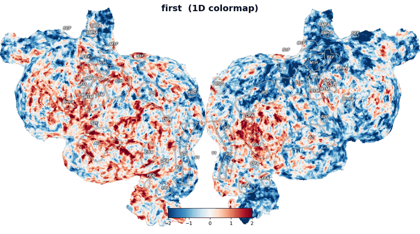

Overview: what pycortex is for
===============================

This page is the "start here." It explains the problem pycortex solves,
gives you a mental model of its main pieces and how data flows between
them, and ends with pointers to a working demo and the example gallery.
To find the right page for whatever you're trying to do, see
:ref:`which-page`. If a term below is unfamiliar, check the :doc:`glossary`.

The end goal: an interactive viewer, that can switch from folded, to inflated and flat surfaces
and that can display your data, ROIs and other anatomical data. Two
independent values per vertex can be shown separately with a 1D
colormap, or combined into one flatmap with a 2D colormap (see
:doc:`colormaps`) (example below).

Why Pycortex?
------------------------------------

FMRI data is a 3D grid of voxels, changing over time. Scrolling through 2D
slices makes it hard to build a mental map of activity across the whole,
deeply folded cortex, and "glass brain" projections that show everything
at once throw away exactly the location information you need to say
*where* on the cortex something happened. Rendering the data on a 3D surface mesh helps, 
but the usual approach can blur or misplace detail wherever the mesh's vertices happen 
to be sparse.
Pycortex instead uses **pixel-wise sampling** for a visibly crisper, more
faithful image.

Pycortex lets you move interactively between the folded,
inflated, and flattened views of the same surface. Being able
to morph between them live allows you to reap benefits of all views.
You can build intuition for *where on the folded brain* a
feature on the flatmap actually lives while also seeing the whole cortex at once.

This reasoning is laid out in more technical depth in
the :ref:`pycortex paper <citation>`.

The core mental model
----------------------

Pycortex treats functional data as a plain array with no built-in
anatomical meaning. A :term:`transform <xfm / transform>` records how one
particular scan's voxel grid lines up with a subject's own cortical
surface, and a :term:`mask` (see :doc:`masks`) narrows that
array down to the voxels near the cortex without ever modifying the data
itself. That's why Phase 1 below is about getting surfaces and a
transform into the :term:`filestore` — pycortex needs that mapping in
place before it can put your numbers on the right piece of cortex.

**Phase 1: one-time setup, per subject**

Pycortex is for taking a data array that you
have and displaying it, richly and interactively, on the
cortical surface. The setup phase exists purely to make that display
phase possible by getting a subject's surfaces and at
least one functional-to-anatomical transform into the pycortex
:term:`filestore` in the layout :doc:`database` expects. An example of this 
minimal layout is given in :ref:`minimal-filestore-contents`.

How you get there depends on what you already have; see
:doc:`importing_other_software` for FreeSurfer, fMRIPrep, HCP, fsaverage,
AFNI, BrainVoyager and other tools. To set up a subject from scratch, see
:doc:`subject_setup`.

**Phase 2: every time you have data to look at (this is most of what
pycortex does)**

.. code-block:: text

    functional data (a voxel array) + a mask
            │  Combine the subject + transform + mask to
            │  create a cortex.Volume or cortex.Vertex object
            ▼
    cortex.Volume  or  cortex.Vertex
            │  (VolumeRGB / Volume2D and their Vertex counterparts, for
            │  precomputed colors or two or three jointly-colormapped quantities)
            │
            ├──► cortex.quickflat.make_figure / make_png / make_svg
            │        -> static flatmap image, with optional layers:
            │           ROI outlines & labels, sulci, curvature shading,
            │           dropout hatching, colorbar, cutouts — see
            │           :doc:`rois` and :doc:`colormaps`
            │
            └──► cortex.webgl.show / cortex.webgl.make_static
                     -> interactive viewer in a browser: drag between
                        folded/inflated/flattened, switch datasets and
                        colormaps live, draw ROIs/sulci in-browser (see
                        :doc:`roidraw`), save/restore viewpoints, play
                        back time-series data — see :doc:`webgl`

``cortex.quickshow`` is an alias for ``cortex.quickflat.make_figure``,
and ``cortex.webshow`` is an alias for ``cortex.webgl.show`` — both used
throughout the docs and examples. The Phase 2 options above are only a
summary; :doc:`auto_examples/index` has real, runnable code for most of
them. For a single script that runs this whole diagram top to bottom
using nothing but the bundled ``S1`` subject, see
:ref:`sphx_glr_auto_examples_quickstart_plot_pipeline_overview.py`.

**Phase 3: have fun exploring!**

Once the basics work, the Example and Features section of the sidebar collect
optional extras. Recently added features include:

* :doc:`features/camera_views_animations` — jump to standard or saved
  camera views, and build keyframe animations rendered frame by frame.
* :doc:`features/bumpy_flatmap` — give the flatmap shaded relief, so the
  folding stays readable after unfolding.

:doc:`auto_examples/index` has plenty more — most examples are short and
meant to be copied and adapted directly rather than read end to end.